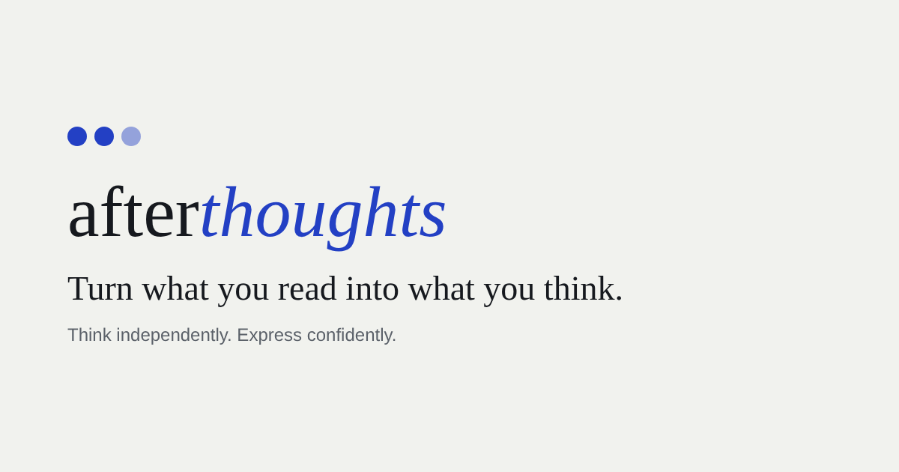
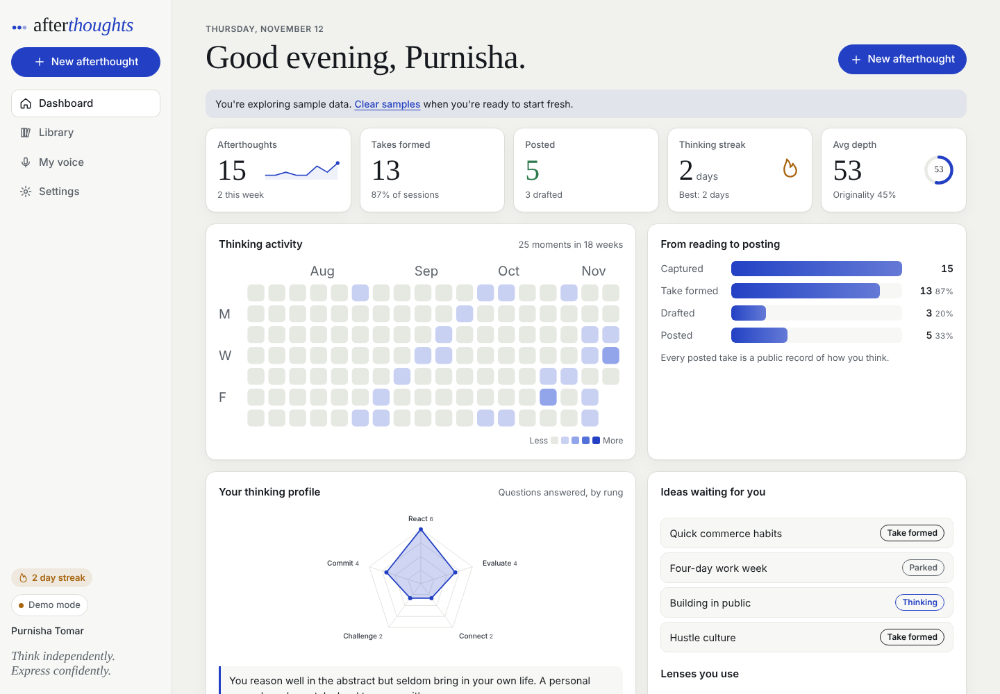
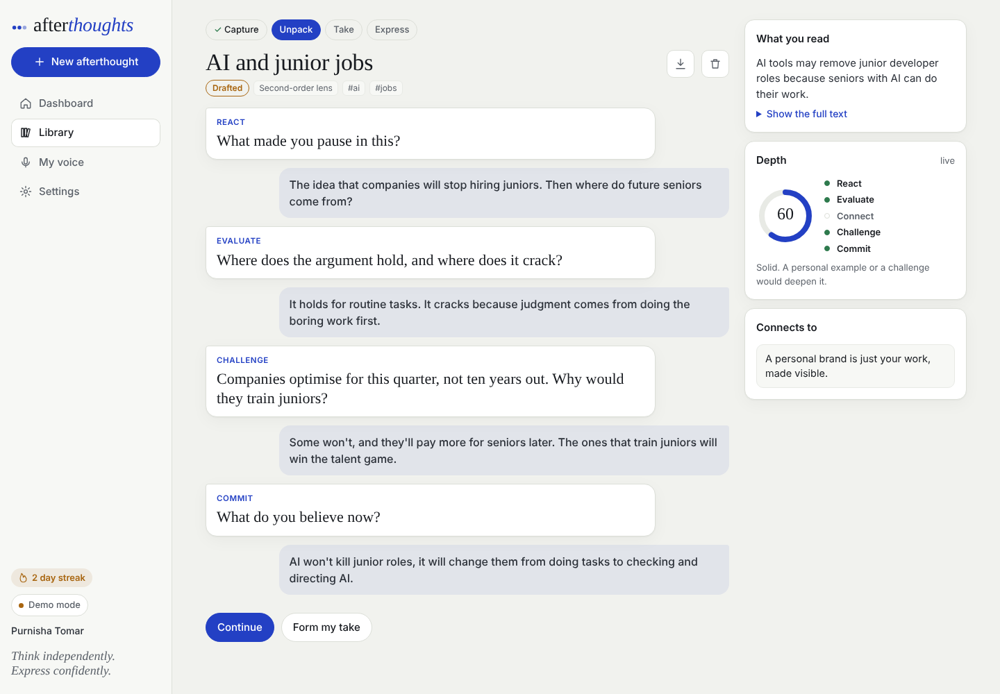
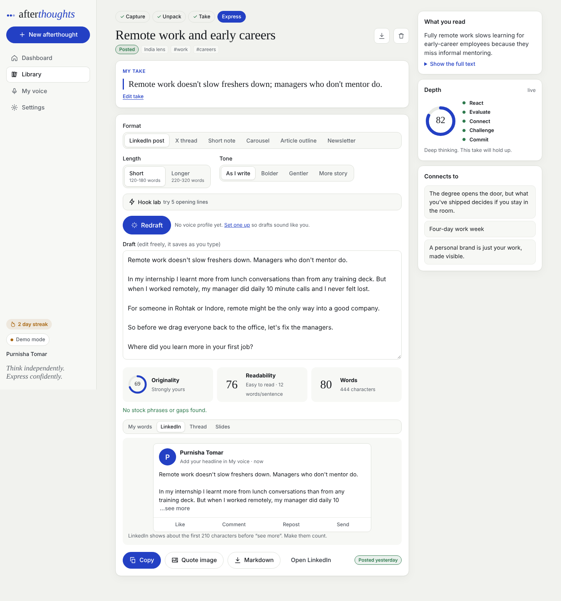
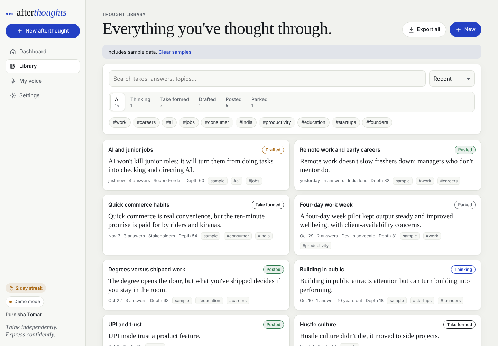
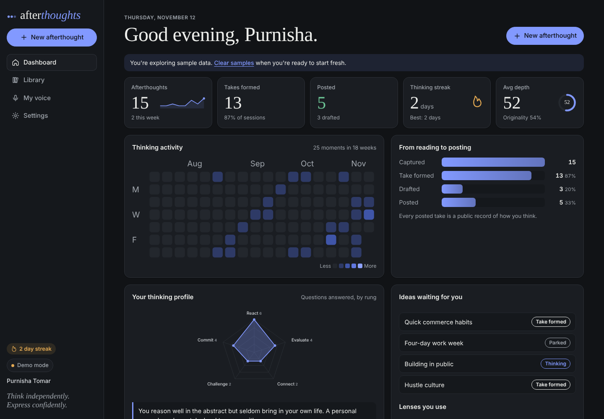
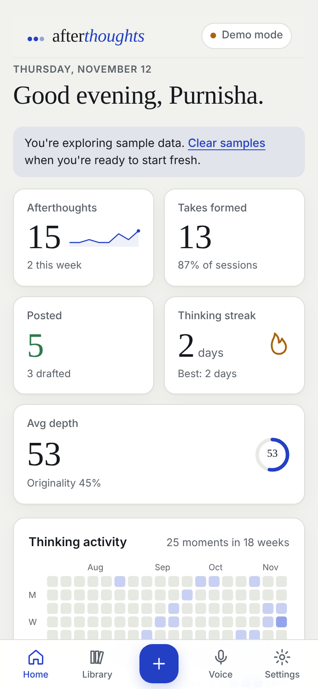
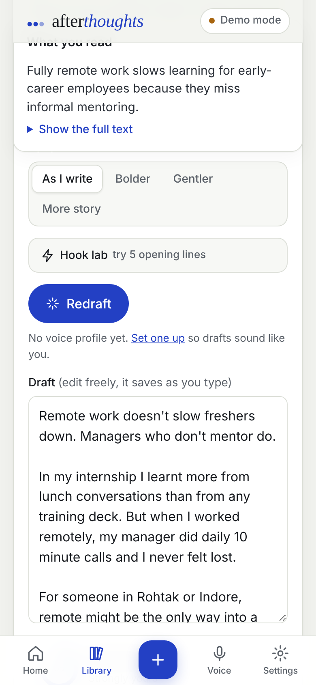

<p align="center">
  
</p>

<h1 align="center">Afterthoughts</h1>
<p align="center"><b>Think independently. Express confidently.</b><br>
<i>Made for Purnisha Tomar.</i><br>
An AI thinking partner that helps you turn what you read into your own point of view, then into posts that sound like you.</p>

<p align="center">
  <a href="#run-it-in-60-seconds">Run it</a> ·
  <a href="docs/DEPLOY.md">Deploy</a> ·
  <a href="docs/PRODUCT.md">Product</a> ·
  <a href="docs/ARCHITECTURE.md">Architecture</a> ·
  <a href="docs/PRIVACY.md">Privacy</a>
</p>

---

## Why it exists

Every day we read articles, posts, news and research. We react, but we rarely take the time to work out what we actually think, and when we do try to post, generic AI tools write *for* us, so everyone ends up sounding the same.

Afterthoughts does the opposite. It never writes until you've thought. It asks sharp questions one at a time, pushes back on you, shows you other perspectives, and only then helps you express **your** take, using **your** words, in **your** voice. An originality meter shows how much of every draft came from you.



## What it does

| Stage | What happens |
| --- | --- |
| **Capture** | Paste an article or post, add a link, upload a screenshot (read by AI), or just jot a passing thought. Pick a thinking lens and a depth. |
| **Unpack** | A thinking partner asks 3, 5 or 7 questions up a five-rung ladder: React, Evaluate, Connect, Challenge, Commit. You can **Push back** (it argues the other side), **Go deeper**, say **I'm not sure** (it offers contrasting positions), or see the idea **through other eyes** (an economist, a founder, a parent in a tier-2 city…). Answer by typing or by **voice**. A live **depth score** tracks how far you went. |
| **Take** | Your stance in one sentence plus your reasons, built only from your answers. A **clarity check** scores it out of 10, flags vagueness, overgeneralisation and thinking biases, and gives you questions that would sharpen it. Set your confidence, tag it, or park it for later. |
| **Express** | Six formats: LinkedIn post, X thread, short note, carousel, article outline, newsletter. Four tones. A **hook lab** with five opening lines. Live **originality**, readability, cliché and gap checks, a LinkedIn feed preview with the "see more" cut-off, per-post character counts for threads, slide previews, **quote-card images** sized for LinkedIn and Instagram, Markdown export and draft versions. |

And around it:

- **Dashboard** with an activity heatmap, thinking streak, a radar of your thinking profile (with a personalised insight), a funnel from reading to posting, lenses you use, themes you return to, ideas waiting for you, recent takes and an AI-written **weekly reflection**.
- **Thought Library** with full-text search across takes and answers, status and tag filters, sorting by depth or originality, and export of everything to Markdown.
- **My voice**: paste your past writing and Afterthoughts measures your **Voice DNA** (sentence length, register, how often you ask questions, signature words) and uses it in every draft.
- **Today's provocation**: a daily question to think about when you have nothing to bring.
- **Connections**: each take shows related takes from your past.
- **Works offline** as an installable app (PWA), light and dark themes, keyboard shortcuts (`n` new, `/` search), and sample data so a first-time visitor sees a full dashboard in one tap.

<table>
<tr>
<td></td>
<td></td>
</tr>
<tr>
<td></td>
<td></td>
</tr>
</table>

<p align="center"> </p>

## AI: five ways to run it

| Mode | Who pays | Setup |
| --- | --- | --- |
| **Demo mode** (default) | Nobody | None. Questions come from a curated bank; takes and drafts are assembled only from your own sentences. Great for trying it out. |
| **Google Gemini** | You (free tier available) | Paste a key from [aistudio.google.com](https://aistudio.google.com/apikey) in Settings. |
| **Anthropic Claude** | You | Paste a key from [console.anthropic.com](https://console.anthropic.com/settings/keys) in Settings. |
| **OpenAI** | You | Paste a key from [platform.openai.com](https://platform.openai.com/api-keys) in Settings. |
| **My server** | The site owner | Deploy `api/ai.js` with a key in environment variables. Every visitor gets the real thinking partner with no setup. See [docs/DEPLOY.md](docs/DEPLOY.md). |

Model names are editable in Settings, so when a provider releases a new model you change one field, not the code.

## Run it in 60 seconds

There is **no build step and no dependencies**. It's plain HTML, CSS and JavaScript.

```bash
git clone https://github.com/<your-username>/afterthoughts.git
cd afterthoughts
npx serve .          # or: python3 -m http.server 5173
```

Open the address it prints. That's it.

Want a single file instead? `python3 tools/build_standalone.py` writes `dist/afterthoughts.html`, the entire app in one file you can open from your computer, email, or upload to any website builder.

## Host it anywhere

Because it's static, Afterthoughts runs on any host: Vercel, Netlify, GitHub Pages, Cloudflare Pages, Hostinger, your college server, or a folder on an existing website. Step-by-step instructions for each are in **[docs/DEPLOY.md](docs/DEPLOY.md)**.

**Put it inside an existing site** with one line:

```html
<iframe src="https://YOUR-AFTERTHOUGHTS-URL/?embed=1" style="width:100%;height:900px;border:0;border-radius:16px" allow="microphone; clipboard-write" title="Afterthoughts"></iframe>
```

`?embed=1` hides the app's own navigation so it sits cleanly inside your page.

## Your data

Local-first: every afterthought, your voice profile and your settings live in your own browser. There is no account, no database and no analytics. The only data that leaves the device is the text of each AI request, sent to the provider you chose. Export a backup any time from Settings. Full details in [docs/PRIVACY.md](docs/PRIVACY.md).

## Project structure

```
afterthoughts/
├── index.html              App shell (sidebar, tab bar, script order)
├── config.js               Site owner settings (default AI provider)
├── css/app.css             All styles, light and dark themes
├── js/
│   ├── core.js             Helpers, constants, local storage
│   ├── ai.js               AI providers + every AI feature (with prompts)
│   ├── demo.js             Offline demo engine
│   ├── insights.js         Depth, originality, readability, Voice DNA, stats
│   ├── charts.js           SVG charts (heatmap, radar, funnel, rings)
│   ├── samples.js          Sample library for first-time visitors
│   ├── ui.js               Modal, cards, voice input, quote-card images
│   ├── view-*.js           Dashboard, think flow, library, voice, settings
│   └── app.js              Router, theme, PWA, shortcuts
├── api/ai.js               Optional server proxy (Vercel); also fetches article text
├── netlify/functions/ai.js Same proxy for Netlify
├── sw.js, manifest.webmanifest   Offline + installable app
├── tools/build_standalone.py      One-file build
└── docs/                   Deploy, product, architecture, privacy, screenshots
```

## Roadmap

- Accounts and sync across devices (Supabase), keeping local-first as the default
- Chrome extension: "Think about this" on any page
- Share-to-Afterthoughts from the phone share sheet and WhatsApp
- YouTube and podcast transcripts as sources
- Payments for a Pro plan (Razorpay, UPI) and a campus plan for colleges
- Peer feedback on a take before posting

## Credits

Made for **Purnisha Tomar**. Fonts: Instrument Serif and Geist (Google Fonts, Open Font License).

© 2026 Purnisha Tomar. All rights reserved. See [LICENSE](LICENSE).
